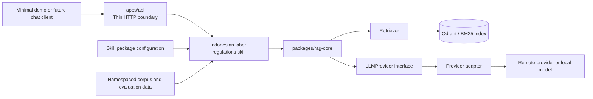
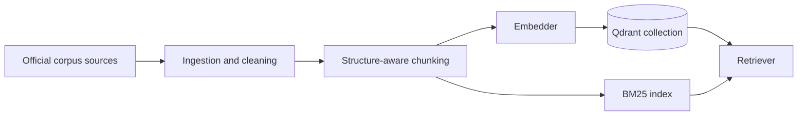
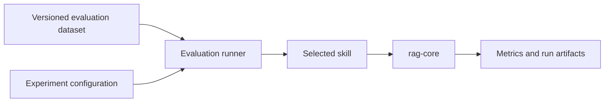

# Architecture

## Status and intent

This document describes the target architecture. The repository is still in its documentation foundation stage; the components below will be implemented incrementally according to the [roadmap](roadmap.md). Foundational decisions are recorded in [ADR-000](adr/000-monorepo-and-skill-architecture.md), [ADR-001](adr/001-llm-and-embedding-provider-strategy.md), and [ADR-002](adr/002-initial-technology-baseline.md).

The first deliverable is a RAG skill for Indonesian labor regulations. The shared engine stays independent of that domain so later skills and assistant workflows can reuse it.

## Target system

During the first RAG release, the API invokes the initial skill directly. A general skill registry and orchestration layer are later extensions, not prerequisites for the initial skill.

Indexing uses the same skill configuration and core contracts as the application path:

Evaluation also uses the same boundaries:

## Planned package responsibilities

| Location                               | Responsibility                                                                                                                                                 | Must not own                                                                          |
| -------------------------------------- | -------------------------------------------------------------------------------------------------------------------------------------------------------------- | ------------------------------------------------------------------------------------- |
| `packages/rag-core/`                   | Reusable ingestion, chunking, retrieval, generation contracts, provider adapters, guardrails, observability instrumentation, and generic evaluation utilities. | Labor-law assumptions, corpus-specific prompts, or skill-specific evaluation answers. |
| `skills/indonesian-labor-regulations/` | Domain configuration, prompts, evaluation specification, guardrails, disclaimer, and glue; logical owner of its namespaced data.                               | Duplicate generic retrieval, provider, or evaluation mechanics.                       |
| `apps/api/`                            | HTTP schemas, request validation, auth and rate limiting when exposed, endpoint handling, and translation between transport and application contracts.         | Retrieval or generation business logic embedded in route handlers.                    |
| `data/`                                | Per-skill manifests, checksums, evaluation data, and optional samples under `data/<area>/<skill_id>/`; raw and processed files are local by default.           | Application code or generated reports.                                                |
| `reports/`                             | Generated experiment outputs, metrics, and run artifacts.                                                                                                      | Published documentation or hand-maintained source material.                           |
| `docs/`                                | Architecture, roadmap, guides, contracts, published evaluation summaries, data and model cards, and accepted decisions.                                        | Claims that planned components are already implemented.                               |

## Workspace and package naming

The workspace uses `uv`. Each directory under `packages/`, `skills/`, and `apps/` is a Python workspace member when introduced.

| Path                                   | Project name                                       | Import name                    | Notes                                                                       |
| -------------------------------------- | -------------------------------------------------- | ------------------------------ | --------------------------------------------------------------------------- |
| `packages/rag-core/`                   | `easy-sidekick-rag-core`                           | `rag_core`                     | Reusable engine.                                                            |
| `skills/indonesian-labor-regulations/` | `easy-sidekick-skill-indonesian-labor-regulations` | `indonesian_labor_regulations` | Initial skill package.                                                      |
| `apps/api/`                            | `easy-sidekick-api`                                | `easy_sidekick_api`            | Added in Phase 2 as a workspace member.                                     |
| `apps/demo/`                           | Optional                                           | —                              | A minimal demo, if implemented, must consume the API rather than bypass it. |

## Core contracts

The following contracts are small Python protocols or typed interfaces. Baseline signatures are defined in Phase 0, finalized during implementation where needed, and covered by contract tests. A material change to a contract requires an ADR or an explicit roadmap update.

| Contract      | Responsibility                                                                                       | Baseline behavior                                                                                                                                         |
| ------------- | ---------------------------------------------------------------------------------------------------- | --------------------------------------------------------------------------------------------------------------------------------------------------------- |
| `Embedder`    | Convert query and document text into embeddings; support local and remote implementations.           | Embed documents and queries; expose model identifier and dimension.                                                                                       |
| `VectorStore` | Upsert, search, and remove vectors with metadata and skill-scoped collections.                       | Ensure collection, upsert points, search with filters, delete by filter, report health.                                                                   |
| `Retriever`   | Return ranked source passages for a query, with source identifiers and retrieval metadata.           | Retrieve by query, top-k, and filters; report scores and strategy metadata.                                                                               |
| `LLMProvider` | Generate structured or unstructured completions and stream output through a normalized interface.    | Generate, stream, expose capabilities, normalize provider errors, report usage.                                                                           |
| `Answerer`    | Build grounded answers from a query and retrieved context, including citations and abstention state. | Return an answered or abstained result with citations, prompt version, usage, and disclaimer.                                                             |
| `Skill`       | Provide domain configuration and invoke core capabilities without coupling the engine to the domain. | Supply corpus manifest, retrieval configuration, prompts, evaluation specification, and domain guardrails; wire core components without duplicating them. |

Keep contracts focused on behavior the application actually needs. Do not add abstractions for hypothetical providers or skills without a concrete use case.

Ownership and phase: `rag-core` owns the core contracts; the skill owns domain configuration and guardrail rules; `apps/api` owns transport schemas. Phase 0 baselines all six contracts with mock contract tests; Phase 2 implements `LLMProvider` integration and `Answerer` against those baselines.

## Data model

These types are shared across the engine, API, and evaluation harness. Field names are English; user-facing content may be Indonesian.

| Type            | Minimum fields                                                                                                         |
| --------------- | ---------------------------------------------------------------------------------------------------------------------- |
| `Document`      | `document_id`, `title`, `document_type`, `number`, `year`, `effective_date`, `status`, `source_url`, `checksum_sha256` |
| `Chunk`         | `chunk_id`, `document_id`, `text`, `article`, `paragraph`, `page`, `metadata`                                          |
| `Passage`       | `source_id`, `text`, `score`, `metadata`                                                                               |
| `Citation`      | `citation_id`, `source_id`, `document_id`, `title`, `url`, `page`, `article`, `quote`                                  |
| `AnswerResult`  | `status`, `answer`, `citations`, `abstention_reason`, `message`, `usage`, `prompt_version`, `disclaimer`               |
| `LLMResponse`   | `text`, `structured_output`, `usage`, `provider`, `model`, `finish_reason`                                             |
| `ProviderError` | `code`, `retryable`, `provider`, `http_status`, `message`                                                              |

`status` is either `answered` or `abstained`. Invalid or unsupported citations are handled according to the [API contract](api.md), not silently presented as grounded answers. `chunk_id` is the storage-level identifier; `source_id` is the citation-facing identifier for a retrieved chunk or passage. They may share a value, but the contract must not depend on that.

## Domain and data boundaries

- Generic parsing, cleaning, chunking, retrieval, and evaluation mechanics belong in `rag-core`.
- A skill supplies its configuration, prompts, evaluation specification, experiment configurations, domain guardrails, and domain-specific metadata rules. Its manifests, datasets, raw sources, and processed text are stored under skill-namespaced paths in the repository-level `data/` tree.
- Each skill uses a separate vector-store collection or namespace so indexes and filters do not mix accidentally.
- Corpus and evaluation content for the first skill are Indonesian. Maintained code, documentation, prompt templates, and dataset field names are English; prompt templates instruct the model to produce Indonesian user-facing answers.
- Adding another domain should normally require a new skill package and configuration, not a fork of `rag-core`.
- Corpus storage, licensing, checksums, and versioning are defined in the [data guide](data.md). Each data artifact is physically namespaced by stable skill ID while remaining logically owned by that skill.

## LLM and embedding provider strategy

The `LLMProvider` interface is the application-facing contract. An OpenAI-compatible API adapter is the initial shared integration path for providers that support it. A provider-specific adapter can be added when compatibility is incomplete or a required capability is unavailable through the shared API.

Configuration selects the provider, model, and optional base URL without changing application code. Secret values are supplied through environment-based configuration. The first provider matrix evaluates 2–3 remote free-tier candidates and a local Ollama model; provider names, quotas, regions, and fallback behavior are recorded in the experiment configuration for the run. Provider quotas and capabilities must be verified during implementation.

Streaming and structured output are explicit parts of the contract. Because providers differ in their support and response formats, adapters must normalize supported behavior and expose or handle unsupported capabilities rather than silently assuming equivalence. Provider errors are normalized into retryable and non-retryable categories.

Embeddings have a separate `Embedder` interface. The initial default is local `bge-m3` dense embeddings; sparse and multi-vector modes are experiments. Other local or hosted embedding implementations can be added independently of the generation provider. See [ADR-001](adr/001-llm-and-embedding-provider-strategy.md) and [ADR-002](adr/002-initial-technology-baseline.md).

## Retrieval design

The initial retrieval baseline combines:

- structure-aware chunking by article (`Pasal`) and paragraph (`Ayat`), with fixed-size chunks as a comparison;
- local `bge-m3` dense embeddings stored in Qdrant;
- BM25 as an independent lexical baseline;
- hybrid retrieval using Reciprocal Rank Fusion.

Collection schema, chunk identifiers, tokenization, BM25 implementation, and experiment results are documented in the [retrieval design](retrieval.md). The skill owns corpus-specific metadata rules; `rag-core` owns the generic retrieval mechanics.

## Guardrails and security boundaries

| Layer      | Responsibilities                                                                                                                                                                                                          |
| ---------- | ------------------------------------------------------------------------------------------------------------------------------------------------------------------------------------------------------------------------- |
| `apps/api` | Request schema validation, maximum input size, request timeout, authentication and rate limiting when exposed, CORS allowlist, and normalized HTTP errors.                                                                |
| `rag-core` | Treat retrieved text as untrusted data, delimit context clearly, validate structured output, validate citations against retrieved passages, apply redaction, and avoid logging secrets or raw sensitive input by default. |
| Skill      | Domain-specific abstention rules, preference for official sources, and a standard disclaimer that responses are informational and not legal advice.                                                                       |

Prompt-injection defenses, adversarial tests, and provider-failure handling are part of the testing strategy. The API is local-only by default for v1.0; public exposure requires the controls defined in the [API contract](api.md).

## Observability

Observability is owned jointly by `rag-core` instrumentation and API middleware, with the skill adding domain attributes. Traces must cover:

- request handling;
- retrieval;
- generation;
- validation and abstention.

Minimum attributes include skill ID, provider, model, prompt version, retrieval strategy, retrieval top-k, citation count, abstention reason, input/output token counts, and latency. Raw questions and retrieved context are not logged by default. The default local retention is seven days for span metadata; any explicit debug capture of raw content is redacted and time-limited, and public deployments must document their retention policy. Arize Phoenix is the initial local viewer, subject to the resource check in Phase 3. Span names, attributes, and retention rules are documented with the evaluation guide.

## Data and request flow

### Indexing

1. A skill identifies its source documents, metadata rules, and licensing constraints.
2. The ingestion pipeline extracts text, normalizes content, and preserves source references.
3. The chunker produces passages with stable identifiers and metadata.
4. The skill's embedder and vector-store configuration build or update its index; BM25 data is prepared for the selected retrieval implementation.
5. The index build records a manifest with corpus checksums, configuration, model revision, and code revision.

### Answering

1. The API validates the request and dispatches to the initial skill; no registry is involved in v1.0.
2. The skill calls the retriever with the question and configured filters.
3. The answerer provides the question and retrieved passages to the configured model provider.
4. The response is validated, citations are checked against retrieved sources, and the answer or abstention is returned.
5. Observability records request stages, provider/model identifiers, latency, and token usage without storing unnecessary sensitive input.

### Evaluation

1. The runner loads a versioned dataset and experiment configuration.
2. Each question is processed through the selected skill and core contracts.
3. Retrieval and answer metrics are calculated and written with the configuration, prompt version, provider/model, environment, and code revision needed to interpret the result.

## Evolution toward Easy Sidekick

The first phases establish one skill and a reliable RAG core. Later phases may add a conversation layer, skill registry, structured tool invocation, and an MCP interface. Agent loops and graph-assisted retrieval are experiments that must be evaluated against the existing baseline before they become default behavior.
